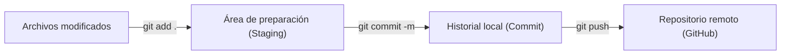

# 🚀 Convenciones y nomenclaturas del proyecto

¡Bienvenido al proyecto! 👋

Para mantener nuestro código organizado, facilitar el trabajo en equipo y evitar confusiones, definimos las siguientes convenciones para los repositorios, las ramas de Git, el flujo de trabajo diario y el versionado del proyecto.

La idea es que todos trabajemos bajo los mismos estándares para que el desarrollo, el mantenimiento y los despliegues sean más sencillos.

---

## 📌 1. Información general

- **Nombre del proyecto:** `umayuq-tariq`

---

## 📂 2. Nomenclatura de repositorios

Para identificar fácilmente cada parte de la aplicación, los repositorios seguirán el formato:

`<tecnología>-tariq`

Utilizaremos **Kebab Case**: todo en minúsculas y con guiones medios (`-`) para separar las palabras.

| Componente | Formato |
|---|---|
| Backend | `django-tariq` |
| Frontend | `react-tariq` |

**💡 ¿Por qué lo hacemos así?**

Porque podremos reconocer rápidamente la tecnología y el propósito de cada repositorio.

---

## 🌿 3. Nomenclatura de ramas (Branches)

### 🌲 Ramas principales (Estrategia de ramificación)

- **`main`**: Rama de **producción**. Contiene el código estable y desplegado en el entorno productivo. No se realizan cambios directos en esta rama.
- **`develop`**: Rama de **desarrollo**. Es la rama base de integración donde se consolidan todos los cambios para la siguiente versión.

**Flujo y origen de las ramas:**
- De **`develop`** se desprenderán el resto de ramas de trabajo (`feature/`, `fix/`, `docs/`, `chore/` y `test/`). Una vez finalizadas y aprobadas, se fusionan de vuelta a `develop`.
- **Excepción:** La rama **`hotfix/`** es la única que se desprende directamente de **`main`**, ya que se utiliza para atender errores críticos y urgentes en producción (al resolverse, se fusiona tanto en `main` como en `develop`).

### 🏷️ Estructura y nombres de ramas

Cada rama debe tener un nombre claro y descriptivo que permita identificar el tipo de trabajo que se está realizando.

Utilizaremos **Kebab Case** y la siguiente estructura:

`<tipo>/<id-issue>-<descripcion-corta>`

El ID del issue es opcional, pero recomendamos incluirlo para relacionar el código con la tarea correspondiente.

**Ejemplo:**

`feature/123-nueva-pasarela-pagos`

### 🛠️ Tipos de ramas

| Prefijo | Rama origen | ¿Cuándo utilizarlo? | Ejemplo |
|---|---|---|---|
| `feature/` | `develop` | Para desarrollar nuevas funcionalidades. | `feature/123-login-usuarios` |
| `fix/` | `develop` | Para corregir errores detectados durante el desarrollo o las pruebas. | `fix/124-error-validacion` |
| `hotfix/` | `main` | Para solucionar errores críticos en producción (urgencias). | `hotfix/125-error-autenticacion` |
| `docs/` | `develop` | Para crear o actualizar documentación. | `docs/126-actualizar-readme` |
| `chore/` | `develop` | Para tareas de mantenimiento, configuración o actualización de dependencias. | `chore/127-actualizar-dependencias` |
| `test/` | `develop` | Para agregar o corregir pruebas automatizadas. | `test/128-pruebas-usuarios` |

**✅ Buenas prácticas para crear ramas**

- Utiliza nombres cortos, claros y descriptivos.
- Escribe siempre en minúsculas.
- Separa las palabras con guiones medios (`-`).
- Evita espacios, tildes y caracteres especiales.
- Incluye el ID del issue cuando exista.
- Utiliza el prefijo que mejor represente el objetivo de tu tarea.

---

## 💻 4. Guía de trabajo con Git

En esta sección se detallan los comandos más utilizados y el paso a paso para crear ramas, guardar cambios y realizar integraciones mediante Pull Requests.

### 4.1 Creación y gestión de ramas

Antes de comenzar una nueva tarea, debes crear tu rama de trabajo a partir de la rama adecuada (`develop` o `main` para hotfix).

**Comandos útiles:**

- **`git branch`**  
  Muestra la lista de ramas locales y resalta con un asterisco `*` en cuál te encuentras actualmente.
  ```bash
  git branch
  ```

- **`git branch -a`**  
  Lista **todas** las ramas existentes, tanto locales como remotas (`remotes/origin/...`).
  ```bash
  git branch -a
  ```

- **`git checkout -b <nombre-de-rama>`**  
  Crea una nueva rama a partir de donde estás parado y se cambia automáticamente a ella en un solo paso.
  ```bash
  # 1. Asegúrate de estar en develop y tener los últimos cambios
  git checkout develop
  git pull origin develop

  # 2. Crea tu nueva rama y cámbiate a ella
  git checkout -b feature/123-login-usuarios
  ```

- **`git push -u origin <nombre-de-rama>`**  
  Publica tu nueva rama en el repositorio remoto (GitHub) por primera vez. El parámetro `-u` (o `--set-upstream`) vincula tu rama local con la remota para que en el futuro solo necesites escribir `git push` o `git pull`.
  ```bash
  git push -u origin feature/123-login-usuarios
  ```

---

### 4.2 Guía de subida de cambios (Guardar y publicar trabajo)

Conforme desarrolles tu tarea, debes registrar y enviar tus avances siguiendo este flujo de 4 pasos:



#### Paso 1: Verificar el estado de los archivos
Antes de guardar, revisa qué archivos han sido modificados, creados o eliminados:
```bash
git status
```

#### Paso 2: Preparar los cambios (`git add`)
Agrega los archivos modificados al área de preparación (*staging*):
- Para agregar **todos** los cambios del directorio actual:
  ```bash
  git add .
  ```
- Para agregar un archivo específico:
  ```bash
  git add ruta/al/archivo.js
  ```

#### Paso 3: Confirmar los cambios (`git commit`)
Empaqueta los cambios preparados en un commit histórico con un mensaje claro y conciso:
```bash
git commit -m "feat: implementar formulario de inicio de sesión"
```
*💡 Consejo:* Usa mensajes descriptivos que expliquen **qué** se hizo (ej. `fix: corregir cálculo de totales`, `docs: actualizar guía de instalación`).

#### Paso 4: Enviar los cambios al repositorio remoto (`git push`)
Sube tus commits al repositorio remoto:
```bash
git push
```
*(Si es la primera vez que subes esa rama, recuerda usar `git push -u origin <nombre-de-rama>`)*.

#### 🔄 Paso adicional: Traer cambios recientes (`git pull`)
Si otro compañero subió cambios a tu misma rama o a la rama base, puedes sincronizarlos ejecutando:
```bash
git pull
```

---

### 4.3 Guía de Pull Requests (PR) y Merges

Cuando hayas terminado tu desarrollo y probado tus cambios localmente, es momento de integrarlos al proyecto mediante un Pull Request.

#### ¿Qué es un Pull Request (PR)?
Es una solicitud formal para que tus compañeros de equipo revisen tu código antes de fusionarlo (*merge*) en la rama principal o de desarrollo. Garantiza la calidad del código y evita conflictos en el proyecto.

#### Paso a paso para abrir y fusionar un PR:

1. **Subir todos tus cambios:**
   Asegúrate de haber hecho `commit` y `push` de tu rama a GitHub:
   ```bash
   git push origin feature/123-login-usuarios
   ```

2. **Crear el Pull Request en GitHub:**
   - Ve a la página del repositorio en GitHub.
   - Verás un aviso con el botón verde **"Compare & pull request"**. Haz clic en él.
   - **Configura las ramas:**
     - **Base (Destino):** `develop` (o `main` si es un `hotfix`).
     - **Compare (Origen):** tu rama de trabajo (ej. `feature/123-login-usuarios`).
   - Escribe un título claro (ej. `[Feature] Login de usuarios con validaciones`) y describe brevemente los cambios realizados.

3. **Revisión de código (Code Review):**
   - Asigna a uno o más revisores del equipo.
   - Si los revisores solicitan correcciones, realízalas en tu misma rama local, haz `git commit` y `git push`. El Pull Request se actualizará automáticamente sin necesidad de abrir otro.

4. **Fusión (Merge):**
   - Una vez aprobado el PR por el equipo y verificadas las pruebas automáticas, se hace clic en **"Merge pull request"** y luego en **"Confirm merge"**.
   - Los cambios ahora formarán parte oficial de `develop`.

5. **Limpieza posterior:**
   - En GitHub, haz clic en **"Delete branch"** para no acumular ramas huérfanas en el repositorio remoto.
   - En tu máquina local, regresa a `develop` y borra la rama que ya fue integrada:
     ```bash
     git checkout develop
     git pull origin develop
     git branch -d feature/123-login-usuarios
     ```

---

## 🏷️ 5. Versionado y etiquetas (Tags)

Para llevar un control claro de las versiones y sus cambios, utilizaremos **Semantic Versioning (SemVer)** o versionado semántico.

El formato será:

`vX.Y.Z`

Por ejemplo: `v1.2.3`

### 🔢 ¿Qué significa cada número?

El versionado sigue el formato `vX.Y.Z`, donde cada número representa un tipo de cambio:

| Número | Tipo | ¿Cuándo se incrementa? | Ejemplo |
|---|---|---|---|
| `X` | **Major (Mayor)** | Cuando se realizan cambios incompatibles con versiones anteriores. | `v1.5.0` → `v2.0.0` |
| `Y` | **Minor (Menor)** | Cuando se agregan nuevas funcionalidades compatibles con versiones anteriores. | `v1.2.3` → `v1.3.0` |
| `Z` | **Patch (Parche)** | Cuando se corrigen errores sin afectar la compatibilidad. | `v1.2.3` → `v1.2.4` |

**En resumen:**

- 🔴 **Major:** cambios importantes que pueden romper la compatibilidad.
- 🟡 **Minor:** nuevas funcionalidades que mantienen la compatibilidad.
- 🟢 **Patch:** correcciones de errores que no afectan la compatibilidad.

**Ejemplo práctico:** si tu proyecto está en la versión `v1.2.3` y corriges un error, la siguiente versión será `v1.2.4`. Si agregas una nueva funcionalidad compatible, será `v1.3.0`. Si introduces un cambio incompatible, será `v2.0.0`.

### 🚢 Creación de tags en Git

Cuando una versión estable esté lista y se despliegue a producción, crearemos un **tag** que identifique el commit exacto asociado a esa versión.

Esto nos permitirá consultar el código de cada lanzamiento y facilitará el seguimiento de las versiones desplegadas.

**Ejemplo: crear el primer release**

```bash
git tag -a v1.0.0 -m "Release inicial"
git push origin v1.0.0
```

El primer comando crea una etiqueta anotada y el segundo la publica en el repositorio remoto.

Para consultar las etiquetas existentes:

```bash
git tag
```

Para crear una nueva versión, recuerda elegir el incremento adecuado según el tipo de cambios realizados.

---

## 🤝 6. Nuestro compromiso

Estas convenciones buscan que el equipo trabaje de forma consistente, que el historial de cambios sea fácil de entender y que cada versión del proyecto pueda identificarse sin complicaciones.

**Antes de crear una rama o publicar una versión, revisa estas reglas y asegúrate de aplicarlas.**

¡Un código organizado facilita el trabajo de todos! 💻✨
